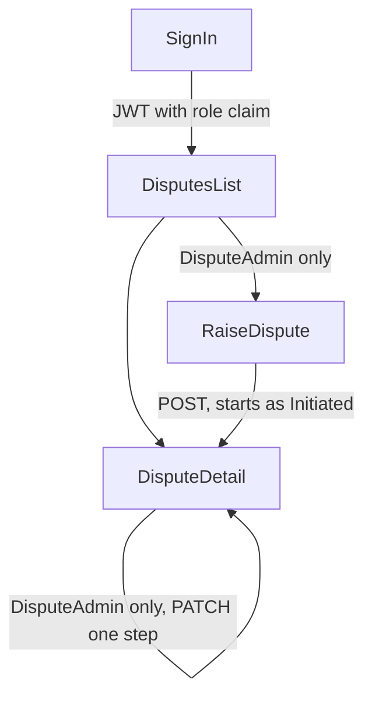

## ADR-003: Frontend UI - 27-10-2026

## Status
Accepted - 2026-10-27

## Context
Until now the portal frontend was still the Vite starter template. Nothing in it referred to a dispute or a transaction. ADR-001 says the frontend serves the data for the disputed transactions, relays status changes back, and distinguishes a ReadOnly role from a DisputeAdmin role. This entry records the decisions taken while actually building that UI: the disputes list, the dispute detail view, the raise form, and sign in.

Two properties of the disputes backend shaped almost every choice below, so they are worth stating up front:

* The API exposes `GET /api/disputes`, `GET /api/disputes/{id}`, `POST /api/disputes` and `PATCH /api/disputes/{id}/status`. There is deliberately no `PUT` and no `DELETE`, because a dispute is an audit trail.
* `Dispute.ChangeStatus` permits a forward move of exactly one step. Initiated to UnderInvestigation to Resolved. Anything else is rejected with a 409.

The flow the UI implements:

## Options Considered
* Edit scope: a full edit form backed by a new `PUT`, a narrow `PATCH` for the reason text, or advancing the status only
* Language: stay with plain JavaScript, or convert the template to TypeScript
* Reaching the API from the browser: a CORS policy in `Program.cs`, or a Vite dev proxy
* Dependencies: hand rolled fetch and form handling, or the idiomatic React stack

## Decision

### 1. "Edit a dispute" means advancing its status, nothing else
The six content fields are immutable once a dispute is raised. The detail page renders them read only and offers at most one action: advance to the single legal next status. A dispute that is Resolved offers nothing.

A general edit form was rejected because it would have no endpoint behind it, and adding `PUT` would reverse the audit trail decision that the disputes backend was built on. Correcting the reason text is a plausible future need, but it is a new endpoint and a separate decision rather than something to smuggle into the UI.

The one step rule is mirrored in exactly one frontend function, `nextStatus`, written as an exhaustive switch. The UI therefore has no status dropdown and no way to express an illegal transition. The 409 path is still handled, because two admins can act on the same dispute concurrently.

### 2. Convert the frontend to TypeScript
The backend contracts are strongly typed and the frontend has to mirror them. TypeScript catches a drifting field name or a wrong status value at build time rather than in the browser. The cost is a one off conversion of the template and a `tsc --noEmit` step in the build script.

### 3. Reach the API through a Vite dev proxy, not a backend CORS policy
The dev server proxies `/api` to the backend, so from the browser every call is same origin and no preflight crosses an origin boundary. This keeps the change entirely on the frontend side and leaves `Program.cs` untouched.

The consequence to accept is that this covers development only. A deployed frontend on a different origin will need a real CORS policy, or it must be served from the API origin.

### 4. Use the idiomatic React stack rather than hand rolling
react-router for routing, TanStack Query for caching and refetch after a mutation, react-hook-form with zod for the raise form, and vitest with Testing Library and msw for tests.

The alternative, a small fetch wrapper plus `useState` and `useEffect`, would have meant hand writing caching, refetch after mutation, and per field error state. The extra dependencies buy behaviour that would otherwise be written badly and tested thinly.

The zod schema mirrors the server's DataAnnotations field for field, so the same rules are enforced before a request is sent and the user sees the failure immediately. It adds one rule the server does not have: at most two decimal places on the amount. The server's `[Range]` ignores scale and the column is `numeric(18,2)`, so Postgres would silently round 10.999 to 11.00. Silently changing a money value is worse than rejecting it.

### 5. Hold the session in localStorage and read the role from the login response
Sign in needed a real login endpoint, which did not exist, so `POST /api/auth/login` was built to complete the seeded sign in from ADR-002. Its response carries the token, its expiry, the email and the role.

Because the role and expiry come back in the response body, the frontend never decodes the JWT. The stored session is dropped on load once past its expiry, rather than waiting for the first 401.

localStorage was chosen so a page refresh keeps the user signed in. The trade off is recorded under Consequences.

The seeded accounts and the signing key are supplied by configuration, through user secrets or a gitignored `.env`, and are never committed. The sign in screen therefore shows no demo credentials.

### 6. The role shapes the UI, the server enforces it
The raise action is hidden from a ReadOnly user and the advance button is not rendered for them. This is presentation only. The backend returns 403 regardless, and the route guard on the raise page explains why access was refused rather than redirecting somewhere unexpected.

## Consequences
**Positive**

- The transition rule exists in one place on the frontend and matches the domain entity, so the UI cannot offer a move the server will reject.
- Mirroring the server validation in zod means an invalid raise attempt costs no round trip, and a server 400 is still mapped back onto the right field when one slips through.
- Every endpoint, role and failure path is covered by tests against a mocked API, so the contract is pinned without needing the backend running.
- No credential is committed. Seed accounts and the signing key come from configuration.

**Negative**

- A dispute's reason cannot be corrected after it is raised. If the business needs that, it is new backend work.
- The Vite proxy solves CORS for development only. Deployment still needs a decision about origins.
- The token sits in localStorage, so any script on the origin can read it. A production build should move to an httpOnly refresh token cookie.
- There is no token refresh. After eight hours the user signs in again.
- There is no transactions service to query, so the transaction id, amount, currency, date and merchant are typed by hand on the raise form and nothing checks that the transaction exists.
- The list has no paging, sorting or search, because the API offers none. This is fine at demo scale and needs server support before the table grows.

## Amendment - 2026-10-27

Recorded when the portal was restyled. No behaviour, contract, route or role rule changed; this amendment covers appearance only.

**Superseded**

Decision 4 above described the stylesheet as neutral banking tokens that were "not official Capitec brand values" and invited the three `--brand-*` values to be swapped. That has now happened, and the swap turned out to be larger than three values.

**The palette**

Five colours, each with a job rather than a decorative role:

- **Blue** is primary. It carries the header ink, every primary action, links, and the Initiated status.
- **Gold** marks the Under investigation status, and is the structural accent: the rule under the app header, the brand mark, and the focus ring.
- **Green** marks the Resolved status.
- **Black** is the ink, from near black headings through to muted supporting text.
- **Red** is reserved exclusively for failure, so it never competes with gold for attention.

The three statuses take the three hues in progression order, so the status column can be scanned by colour while still reading as text. These remain approximations rather than official brand hexes.

**Structure**

The stylesheet is now two layers. Fixed primitive ramps, then semantic tokens that components reference. A component rule that names a primitive directly is treated as a bug, because it will not survive the theme switch. The two deliberate exceptions are the gold brand mark and the gold header rule, which are identical in both themes by intent.

**Icons**

Added `@fortawesome/react-fontawesome` with the free solid set, thirteen icons imported individually rather than through the global library so the bundle carries only what is used. The cost measured out at 27KB gzipped, almost all of it the core runtime rather than the glyphs.

Every icon is decorative and sits beside a visible text label, so all of them keep the default `aria-hidden="true"` and none is given a `title`. On the installed react-fontawesome 3.x a `title` is silently ignored anyway, so passing one would only mislead a reader into thinking the icon is announced. Worth knowing for any future downgrade: the 0.2.x line did render a real `<svg><title>`, and title text counts toward `textContent`, which would break the exact match assertions on the status badge and on two validation messages.

The status badges are the one place the icons do more than decorate. Each status now has its own glyph, so status is carried by shape as well as colour and text, and colour stops being a load bearing channel.

**Dark mode**

The portal follows the operating system through `prefers-color-scheme`. There is no toggle, so no new functionality and no new state. Only the semantic layer re-points; no hue is redefined. Three inversions are worth knowing: the focus ring moves from gold 700 to gold 400, because gold 700 disappears on a dark ground while gold 500 fails the 3:1 contrast floor on a light one; the status chips move from solid pastel fills to low alpha tints of the same hue, because the pastels glare; and the status glyphs need no override at all because they inherit `currentColor`.

Two placement details are load bearing. `color-scheme: light dark` on `html` is what makes the native date picker on the raise form follow the theme. The dark block sits last in the file because a media query adds no specificity, so its two component level overrides would otherwise lose to their light counterparts defined further down.

**Constraint that shaped the work**

The test suite pins the markup harder than it looks. Three assertions in particular dictated implementation: the status badge's text content must equal the status label exactly; the formatted amount must stay a single text node, so the currency symbol is not split out and nothing is added to that cell; and the detail page heading must contain only the merchant name, so no icon went into it.

The disputes table also had to stay a real table. Restyling table parts with `display:` is the usual way to make a table responsive, and it would have passed the suite while silently stripping the table from the accessibility tree, so the table is wrapped in a scrolling region instead. That wrapper carries `role="region"`, a label and `tabIndex={0}`, because otherwise making it scrollable would have put the overflow beyond reach of a keyboard.

Two regression tests were added to hold the invariants that a future change could break without any visible symptom: that the list is still a real table with its six column headers, and that the status badge's text content is still exactly the label.

**Added**

One heading, `Disputes`, on the list page, which previously had no `h1` at all.

## Amendment 2 - 2026-10-27

Adds a theme toggle. This supersedes one sentence in the amendment above, which recorded that the portal followed the operating system with "no toggle, so no new functionality and no new state". A toggle was then asked for, so both halves of that sentence no longer hold: this is new functionality and it does persist state.

## Decision

Two themes, light and dark, and a single header button that flips between them. There is no third "follow the system" mode.

A three state control was built first and then removed on request. Recording why, because the argument for it is the obvious one and will come up again: it would have let a reader return to following the OS after overriding it, which two states cannot offer. It was rejected as not worth the extra mode in the interface. The portal is an internal tool whose users will set this once, so a cycle through three states costs every user clarity in order to serve a rare case.

The OS preference is not ignored entirely. On a first visit, with nothing stored, the initial theme seeds from `prefers-color-scheme`, so a reader whose machine is dark does not get a light portal on first load. That is a default value, not a mode: after the first toggle the stored choice always wins, and nothing tracks the OS once the page has loaded.

The button shows the glyph of the theme it will switch to, a moon while light and a sun while dark, and its accessible name says the same thing.

## Consequences

**Positive**

- One control, two states, no hidden third behaviour to explain.
- A dark machine still gets a dark portal on first load, without a mode to maintain.
- The choice survives a reload, and is stored as the literal theme rather than as an intent, so there is nothing to re-resolve.
- No media query subscription at runtime, so the provider has no listener to attach, leak or clean up.

**Negative**

- Once a reader has toggled, a later change to their OS theme is not picked up. Clearing the `capitec-disputes-theme` key is the only way back to OS seeding. This is the accepted cost of dropping the third mode.
- The resolution rule exists twice: in `src/theme/theme.ts` and as a small inline script in `index.html`. The duplication is deliberate and is the standard way to avoid a flash of the wrong theme, since the attribute has to be on the root element before first paint and React mounts too late for that. The storage key and the two attribute values must stay in step across those files, and a comment in `index.html` says so.
- The stylesheet no longer uses `prefers-color-scheme` at all. The dark palette hangs off `data-theme` on the root element, so the theme depends on JavaScript. Acceptable only because the portal is a React single page app that cannot render without it anyway.

## Implementation notes worth keeping

Switching from a media query to an attribute selector removed a specificity hazard rather than adding one. The previous dark block had to sit last in the file because a media query contributes nothing to specificity, so its two component level overrides would otherwise have lost to their light counterparts. `:root[data-theme='dark']` outranks a bare `:root`, so those overrides now win on specificity and placement is merely tidy. The banner comment in the stylesheet was corrected to say so, because the old one gave a reason that had stopped being true.

`color-scheme` moved from a single `light dark` declaration to one value per theme, so the native date picker on the raise form follows the chosen theme rather than the OS.

`window.matchMedia` is undefined in this project's jsdom, not merely inert. The one remaining read of it, the first visit seed, is therefore optional chained and falls back to light. A test covers that fallback, because an unguarded read would have thrown the moment the provider mounted under test.

The toggle is the one icon only control in the portal, so unlike every other icon its meaning cannot come from an adjacent label. The glyph stays decorative and `aria-hidden`, and the button carries an `aria-label` naming the theme the next click will select. Tests assert that name, assert the button has no text content, and assert that repeated clicking only ever produces the two themes.

## Amendment 3 - 2026-10-28

Two changes, recorded together because they shipped together.

### The transaction id is generated, not entered

The raise form no longer asks for a transaction id. It mints one with `crypto.randomUUID()` and merges it into the payload at submit.

Asking a person to hand-type a 36 character UUID was the worst input in the portal. The value carried nothing the user supplied, it could not be checked by eye, and one wrong character was the likeliest reason a valid dispute would be refused.

**Where the boundary moved.** `createDisputeSchema` now describes only what a human enters, so it covers five fields and no longer validates a UUID. The wire contract did not change: `CreateDisputePayload` is the schema output plus `transactionId`, which is why nothing under `src/api` or `src/hooks` needed editing and the request still carries exactly six keys.

**The id is minted once per form mount, not per submit.** The submit path already retries: a server 400 maps onto a field, the user corrects it and submits again. Generating inside the handler would have sent a different id on each attempt, so one dispute could be refused under one id and accepted under another. A test asserts that a retry after a rejection reuses the first id, because no visible behaviour would reveal the difference. That test was deliberately checked for teeth: moving the generator into the submit handler fails it, and fails nothing else in the suite.

**Two things this also fixed.** A server 400 naming `TransactionId` used to be routed to a form field; now that no such field exists it falls through to the banner, where it is actually readable. And `useState(() => crypto.randomUUID())` is written with the arrow deliberately: passing `crypto.randomUUID` detached from `crypto` throws a `TypeError` in Chrome and in this project's jsdom.

**Worth knowing: the id points at nothing.** A transaction id is meant to reference a transaction that already happened in another system. A GUID minted in the browser references nothing, and two disputes about the same real purchase will now carry different ids. The backend permits this, with `[Required] Guid?`, a non-unique index, no foreign key and no existence check, and with no transaction service in this solution there is nothing better to put there. Read the field as a per-dispute reference rather than as a real transaction pointer. If a transaction service is ever introduced, this is the first decision that has to be revisited, and the id should then come from a lookup rather than from the client.

**Removed.** The test covering a malformed hand-typed UUID was deleted rather than rewritten, because the behaviour it guarded no longer exists. Leaving it would have failed rather than passed, since zod ignores unknown keys and the malformed value would simply have parsed.

### Figtree replaces the system font stack

**Superseded.** The Known Limitations of the restyle amendment said the portal used no webfont and that typography rested on the system stack, so the same build rendered in Segoe UI Variable, SF or Roboto depending on the platform. That is no longer true.

`--sans` now leads with `Figtree`, served from Google Fonts as a variable woff2 over the `wght@300..900` axis. The portal uses 400, 500, 600 and 700, all inside that axis, so every weight is a true weight rather than a synthetic bold, and one file covers all of them.

The system stack stays behind Figtree on purpose. The request carries `display=swap`, so text paints immediately in the OS font and swaps when Figtree arrives, and if the CDN is unreachable the portal renders in the system font with no layout break.

**Delivery.** A stylesheet link in `index.html`, with preconnects to `fonts.googleapis.com` and `fonts.gstatic.com`. The `crossorigin` attribute on the gstatic preconnect is load bearing, since font files are fetched in CORS mode and a preconnect without it warms a connection the browser will not reuse. Self-hosting through `@fontsource-variable/figtree` was considered and rejected in favour of keeping the dependency list unchanged; the trade accepted is two external hosts contacted on every load, and a portal that falls back to system fonts offline. Note for anyone who revisits that choice: the npm package registers the family as `Figtree Variable`, not `Figtree`, so swapping delivery means changing the token too.

Italics were deliberately not requested. Figtree ships an italic axis and nothing in the portal is italic.

`--mono` is unchanged. Figtree has no monospace companion, and `.mono` still carries the transaction id and the session email.

**Not covered by tests.** jsdom neither loads `index.html` nor fetches external stylesheets, so no automated check can observe the typeface. Verification is visual, by reading the rendered font in the Computed panel rather than judging by eye, plus one offline reload to prove the fallback.
