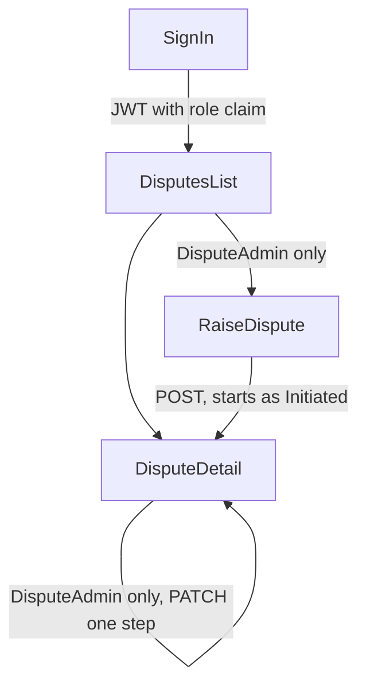

## ADR-003: Frontend UI - 27-10-2026

## Status
Accepted - 2026-10-27

## Context
Until now the portal frontend was still the Vite starter template. Nothing in it referred to a dispute or a transaction. ADR-001 says the frontend serves the data for the disputed transactions, relays status changes back, and distinguishes a ReadOnly role from a DisputeAdmin role. This entry records the decisions taken while actually building that UI: the disputes list, the dispute detail view, the raise form, and sign in.

Two properties of the disputes backend shaped almost every choice below, so they are worth stating up front:

* The API exposes `GET /api/disputes`, `GET /api/disputes/{id}`, `POST /api/disputes` and `PATCH /api/disputes/{id}/status`. There is deliberately no `PUT` and no `DELETE`, because a dispute is an audit trail.
* `Dispute.ChangeStatus` permits a forward move of exactly one step. Initiated to UnderInvestigation to Resolved. Anything else is rejected with a 409.

The flow the UI implements:

## Options Considered
* Edit scope: a full edit form backed by a new `PUT`, a narrow `PATCH` for the reason text, or advancing the status only
* Language: stay with plain JavaScript, or convert the template to TypeScript
* Reaching the API from the browser: a CORS policy in `Program.cs`, or a Vite dev proxy
* Dependencies: hand rolled fetch and form handling, or the idiomatic React stack

## Decision

### 1. "Edit a dispute" means advancing its status, nothing else
The six content fields are immutable once a dispute is raised. The detail page renders them read only and offers at most one action: advance to the single legal next status. A dispute that is Resolved offers nothing.

A general edit form was rejected because it would have no endpoint behind it, and adding `PUT` would reverse the audit trail decision that the disputes backend was built on. Correcting the reason text is a plausible future need, but it is a new endpoint and a separate decision rather than something to smuggle into the UI.

The one step rule is mirrored in exactly one frontend function, `nextStatus`, written as an exhaustive switch. The UI therefore has no status dropdown and no way to express an illegal transition. The 409 path is still handled, because two admins can act on the same dispute concurrently.

### 2. Convert the frontend to TypeScript
The backend contracts are strongly typed and the frontend has to mirror them. TypeScript catches a drifting field name or a wrong status value at build time rather than in the browser. The cost is a one off conversion of the template and a `tsc --noEmit` step in the build script.

### 3. Reach the API through a Vite dev proxy, not a backend CORS policy
The dev server proxies `/api` to the backend, so from the browser every call is same origin and no preflight crosses an origin boundary. This keeps the change entirely on the frontend side and leaves `Program.cs` untouched.

The consequence to accept is that this covers development only. A deployed frontend on a different origin will need a real CORS policy, or it must be served from the API origin.

### 4. Use the idiomatic React stack rather than hand rolling
react-router for routing, TanStack Query for caching and refetch after a mutation, react-hook-form with zod for the raise form, and vitest with Testing Library and msw for tests.

The alternative, a small fetch wrapper plus `useState` and `useEffect`, would have meant hand writing caching, refetch after mutation, and per field error state. The extra dependencies buy behaviour that would otherwise be written badly and tested thinly.

The zod schema mirrors the server's DataAnnotations field for field, so the same rules are enforced before a request is sent and the user sees the failure immediately. It adds one rule the server does not have: at most two decimal places on the amount. The server's `[Range]` ignores scale and the column is `numeric(18,2)`, so Postgres would silently round 10.999 to 11.00. Silently changing a money value is worse than rejecting it.

### 5. Hold the session in localStorage and read the role from the login response
Sign in needed a real login endpoint, which did not exist, so `POST /api/auth/login` was built to complete the seeded sign in from ADR-002. Its response carries the token, its expiry, the email and the role.

Because the role and expiry come back in the response body, the frontend never decodes the JWT. The stored session is dropped on load once past its expiry, rather than waiting for the first 401.

localStorage was chosen so a page refresh keeps the user signed in. The trade off is recorded under Consequences.

The seeded accounts and the signing key are supplied by configuration, through user secrets or a gitignored `.env`, and are never committed. The sign in screen therefore shows no demo credentials.

### 6. The role shapes the UI, the server enforces it
The raise action is hidden from a ReadOnly user and the advance button is not rendered for them. This is presentation only. The backend returns 403 regardless, and the route guard on the raise page explains why access was refused rather than redirecting somewhere unexpected.

## Consequences
**Positive**

- The transition rule exists in one place on the frontend and matches the domain entity, so the UI cannot offer a move the server will reject.
- Mirroring the server validation in zod means an invalid raise attempt costs no round trip, and a server 400 is still mapped back onto the right field when one slips through.
- Every endpoint, role and failure path is covered by tests against a mocked API, so the contract is pinned without needing the backend running.
- No credential is committed. Seed accounts and the signing key come from configuration.

**Negative**

- A dispute's reason cannot be corrected after it is raised. If the business needs that, it is new backend work.
- The Vite proxy solves CORS for development only. Deployment still needs a decision about origins.
- The token sits in localStorage, so any script on the origin can read it. A production build should move to an httpOnly refresh token cookie.
- There is no token refresh. After eight hours the user signs in again.
- There is no transactions service to query, so the transaction id, amount, currency, date and merchant are typed by hand on the raise form and nothing checks that the transaction exists.
- The list has no paging, sorting or search, because the API offers none. This is fine at demo scale and needs server support before the table grows.
