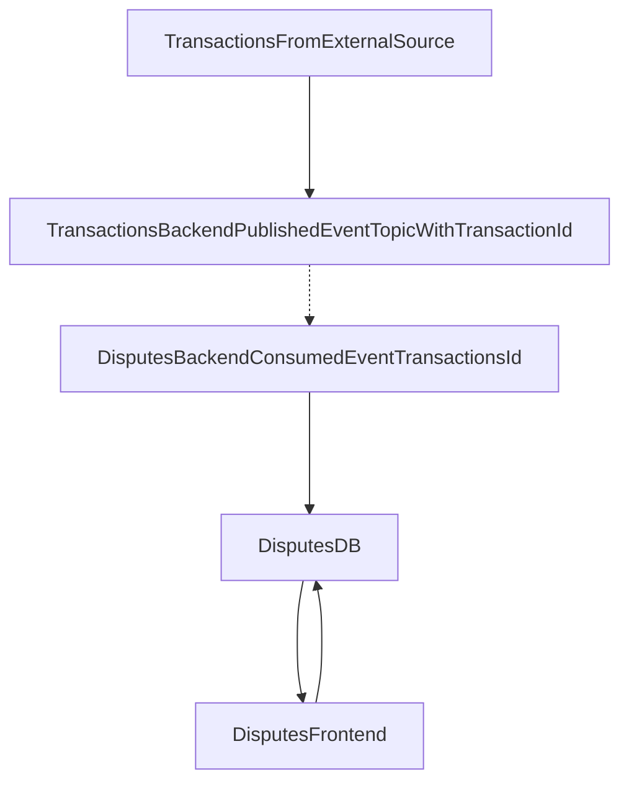

## Initial Implementation - 2026-10-18

This is the first recorded architectural decision for this assessment. The project entails building a Transactions Dispute Portal

The following will be used until the next entry in the ADR. These are the initial builds before any other changes are made, if there are, it will be present in the next ADR

* Disputes - Initiated, Under Investigation, Resolved

* Transactions received from an external source and the dispute has a reference to which transaction is currently being disputed i.e transactionId, disputeSettled

Below is a sketched out diagram of what the dispute flow would look like

* Disputes will consume the event from the transactions backend, which is assumed as built for the sake of this assessment

* The frontend will serve the data for the transactions that are being disputed and will relay any additional information back to the database if any changes are made on the frontend i.e status changes

* The frontend will have roles that are assigned to a user. Readonly, which allows a user to view the disputes. A Dispute admin role will be provided to those who are allowed to change the statuses of the dispute.